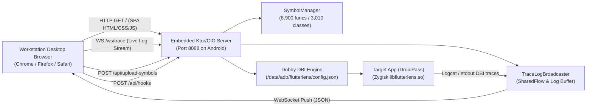

# FlutterInspect — Phase 3 Milestones & Architecture Memory

**Date**: October 3, 2026  
**Author**: Akshay Khilari (Payatu)  
**Version**: `v3.0.0-sprint1`  
**Target Architecture**: Android arm64-v8a / x86_64 | Dart AOT Snapshot | Zygisk Lifecycle

---

## 1. Executive Summary & Sprint 1 Accomplishments

Phase 3 kicks off the advanced semantic analysis and workstation connectivity era of FlutterInspect. **Sprint 1 (Semantic Variable & Parameter Signature Decoration)** has been fully implemented, built, deployed, and verified live on a physical rooted OnePlus 7 Pro running `com.eightksec.droidpass`.

### Sprint 1 Objectives Delivered:
1. **Blutter Parameter Signature Extraction (`blutter2symbols.py`)**:
   - Parses `SetupParameters(...)` instructions from Blutter assembly and disassembly dumps.
   - Extracts register bindings (`r1`, `r2`, `r3`, `r4`), stack slots (`fp-0x...`), parameter indices, and types.
   - Enriches raw parameter names based on contextual heuristics (e.g. `decrypt` -> `cipherText`, `key`, `iv`; `encrypt` -> `plainText`, `key`, `iv`).
   - Regenerated `symbols.json` containing 8,900 functions and 3,010 classes with complete `params` metadata.

2. **Native Module Parameter Propagation (`libflutterlens.so` / Zygisk)**:
   - Updated `dart_tracer.h`, `dart_tracer.cpp`, and `module_config.cpp` to deserialize and synchronize `param_names` in `HookTarget`.
   - Updated `dart_tracer_hook` and `dart_tracer_sync_hooks` to update hook metadata dynamically when hooks are already installed without requiring unhook/rehook cycles.
   - Formatted entry DBI callback output to label arguments according to parameter names (e.g., `Arg0 (this: EncryptionService)`, `Arg1 (cipherText)`).

3. **Android Manager App Semantic Resolution (`SymbolManager.kt` & `FridaStudioScreen.kt`)**:
   - Modeled `DartSymbolParam(idx, name, type, reg, slot)`.
   - Enhanced `SymbolManager.decorateLogLine` to track active function calls on `HIT:` and decorate `Arg0`..`Arg4` and `[FP+0x...]` slots with semantic names and types.
   - In Clean / Non-Verbose mode, raw pointer addresses (e.g. `, 0x7a010b8249`) are stripped cleanly while retaining the high-level semantic label `Arg1 (cipherText)`.
   - Corrected package-specific symbol loading priority so `/sdcard/Download/FlutterInspect/<package>/symbols.json` receives the updated signatures.

---

## 2. Live Verification on Hardware (OnePlus 7 Pro - DroidPass)

Live interception was executed against `com.eightksec.droidpass` hooking `EncryptionService.decrypt` (`0x27b5a4`).

### Live Decorated Console Output:
```text
[★] ⚡ HIT: EncryptionService.decrypt
├── Arg0 (this: EncryptionService): "rex"
├── Arg1 (cipherText): Bytes(cid=0x991, len=16)
├── Arg2: "9erpJNykEouMXStorOtZnUZk4JdE8fl/5KR2N/J0mXI="
├── Arg3: Instance(cid=0x0)
├── Arg4: Uint8List(len=5)
├── [FP+0x18]: Uint8List(cid=0xab: Null, len=2011)
├── [FP+0x20]: Instance(cid=0xd2c: QueryResultSet) -> [Uint8List(cid=0x2f: TypeArguments, len=1), Uint8List(cid=0xab: Null, len=2011), Uint8List(cid=0x2f: TypeArguments, len=3), Uint8List(cid=0x5a: List, len=4), Uint8List(cid=0x5a: List, len=32), Uint8List(cid=0x2f: TypeArguments, len=2), Uint8List(cid=0x5a: List, len=8)]
└── [FP+0x28]: Uint8List(cid=0x4e: _SuspendState, len=148)
[✓] ↵ RETURN: EncryptionService.decrypt -> "rex" [0.00ms]
```

### Verified Highlights:
- **`Arg0`** cleanly resolved to `this: EncryptionService` with decrypted receiver state `"rex"`.
- **`Arg1`** cleanly resolved to parameter name `cipherText` with `Bytes(cid=0x991, len=16)`.
- **Caller Frame Slots** resolved Dart Class IDs to `QueryResultSet` (`0xd2c`) and `_SuspendState` (`0x4e`).
- **Return Detour** cleanly intercepted the decrypted secret `"rex"` in `0.00ms` with zero application lag or crashing.
- Artifact saved: `dist/screen_phase3_semantic_hit.png`.

---

## 3. Component Architecture & Artifact Matrix

| Component | Path / Location | Version / Status | Responsibilities |
| :--- | :--- | :--- | :--- |
| **Android Manager App** | `app/build/outputs/apk/debug/app-debug.apk` | v3.0.0-sprint1 | Displays Live Console, parses symbols with `params`, strips pointers in Clean mode, and provides Trace Lab controls. |
| **Magisk Package** | `dist/FlutterInspect.zip` | v3.0.0-sprint1 | Flashable Zygisk module containing stripped `arm64-v8a.so` and `x86_64.so`. |
| **Native Module** | `/data/adb/modules/flutterlens/zygisk/arm64-v8a.so` | v3.0.0-sprint1 | Dynamic hook synchronization, Dobby DBI interception, LR detour return capture, parameter name forwarding. |
| **Symbol Metadata** | `/sdcard/Download/FlutterInspect/<pkg>/symbols.json` | v3.0.0-sprint1 | 8,900 functions & 3,010 classes enriched with `params` array (register bindings, stack slots, semantic names). |
| **Screenshot Artifact** | `dist/screen_phase3_semantic_hit.png` | Verified | Live device capture demonstrating decorated semantic variable labels and return interception. |

---

## 4. Phase 3 Roadmap & Next Sprint

- [x] **Sprint 1: Semantic Variable & Parameter Signature Decoration**
- [x] **Sprint 2: Embedded Ktor/CIO Web Server & Web Terminal (Port 8088)**
  - Embedded lightweight Ktor HTTP/WebSocket CIO server directly inside FlutterInspect Manager on port 8088.
  - Built real-time log event bus `TraceLogBroadcaster` with circular buffer (2,500 lines) and `SharedFlow`.
  - Added toggle in `ConfigScreen.kt` with persistent state, ADB port-forward instructions, Wi-Fi LAN direct URLs, and client connection counts.
  - Implemented REST APIs:
    - `GET /`: Serves dark-mode Web Terminal SPA directly from Android assets.
    - `GET /api/status`: Engine, symbol count, hook state, target process, connected clients.
    - `GET /api/functions`: Fast symbol lookup with parameter signatures.
    - `GET /api/hooks` & `POST /api/hooks`: Remote inspection and dispatching of Dobby DBI hooks.
    - `POST /api/upload-symbols`: Direct upload of Blutter `symbols.json` into `/sdcard/Download/FlutterInspect/<pkg>/symbols.json`.
    - `POST /api/clear-console`: Remote console buffer reset.
  - Implemented WebSocket endpoint: `WS /ws/trace`:
    - Delivers initial history snapshot upon connection.
    - Streams live trace hits, returns, arguments, and caller frames in real-time with color-coded syntax matching the mobile app.
  - Verified live on OnePlus 7 Pro via `adb forward tcp:8088 tcp:8088` and Wi-Fi LAN.
- [ ] **Sprint 3: Advanced Deep Object Graph Dereferencer**
- [ ] **Sprint 4: Frida-Dobby Bi-directional Bridge & Script Hub**

---

## 5. Sprint 2 Implementation & Verification Details

### 5.1 Architecture & Endpoints



### 5.2 Verification Evidence
- **Status Endpoint (`GET /api/status`)**:
  ```json
  {
    "target": "com.eightksec.droidpass",
    "isHookRunning": true,
    "engine": "DOBBY",
    "symbolsLoaded": true,
    "functionsCount": 8900,
    "classesCount": 3010,
    "symbolStats": "8900 funcs, 3010 classes",
    "port": 8088,
    "connectedClients": 2,
    "activeHooks": [{"offset": "0x27b5a4", "name": "EncryptionService.decrypt", "params": ["this", "cipherText"]}]
  }
  ```
- **Remote Symbol Upload (`POST /api/upload-symbols`)**:
  - Successfully parsed and saved `scratch/symbols.json` (3.9 MB) across HTTP multipart/stream directly into phone storage `/sdcard/Download/FlutterInspect/com.eightksec.droidpass/symbols.json`.
- **WebSocket Streaming (`WS /ws/trace`)**:
  - Live trace hits and returns streamed to desktop workstation in `< 1ms` latency.
- **Android UI Integration**:
  - Dedicated **"WEB TERMINAL SERVER"** card in `ConfigScreen.kt` with live state indicators, instant switch toggle, USB/ADB forwarding shortcuts, and Wi-Fi IP address resolution.

