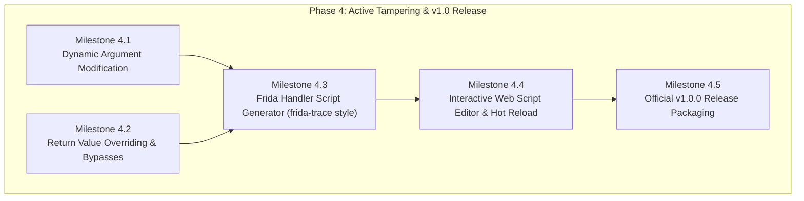

# deFlutter — Phase 4 Milestones, Architecture Memory & v1.0 Roadmap

**Document Version**: 4.0  
**Date**: October 7, 2026  
**Author**: Akshay Khilari (Payatu)  
**Project**: [deFlutter](https://github.com/akhilari7/deFlutter)  
**Repository Remote**: `https://github.com/akhilari7/deFlutter.git` (`branch: main`)  
**Latest Baseline Commit**: `8ef4c5a` (`feat(web): paginate symbols explorer and extract dart file keyword on package inspect`)  
**Primary Test Target**: OnePlus 7 Pro (`2fcddb7d`), Android 12 (Rooted via Magisk / Zygisk)  
**Reference Applications Tested**: `com.eightksec.droidpass` (DroidPass), `com.tatadigital.tcp` (Tata Neu Super App)

---

## 1. Executive Summary & Brain Anchor

**deFlutter** is a dynamic reverse engineering and runtime inspection toolkit specifically engineered for Flutter and Dart AOT applications on Android. It bridges low-level DBI (Dobby), scriptable runtime instrumentation (Frida), Dart VM snapshot internals, and high-level symbol reconstruction (Blutter).

This document serves as the **authoritative source of truth and brain anchor** across sessions, tracking:
1. Exact component versions, binaries, and repository state.
2. Completed milestones leading up to Phase 4.
3. Critical architecture memory (Zygisk memory models, Frida ptrace dynamics, Ktor Web Terminal).
4. The execution roadmap for **Phase 4** (Dynamic argument tampering, return value manipulation, `frida-trace` style handler generators, culminating in the **official v1.0.0 release**).
5. The future vision beyond Phase 4: A **standalone desktop web application and CLI toolkit** decoupling the companion from on-device HTTP hosting.

---

## 2. Component Matrix & Artifact Releases

| Component | Path / Location | Current Version | Details / Responsibilities |
| :--- | :--- | :--- | :--- |
| **Git Repository** | `https://github.com/akhilari7/deFlutter` | `main` (`8ef4c5a`) | Source of truth. Clean root, Apache 2.0 license, complete documentation. |
| **Android Manager App** | `dist/deFlutter-v2.0.0-manager.apk`<br>`app/build/outputs/apk/debug/app-debug.apk` | `v2.0.0`<br>(versionCode 2) | Dual-engine UI, Trace Lab, Frida Studio, embedded Ktor Web Terminal server (`:8088`), Snapshot viewer. |
| **Zygisk Module Package** | `dist/deFlutter-v2.0.0-zygisk.zip` | `v2.0.0`<br>(versionCode 200) | Flashable Magisk/KernelSU module. Module ID: `deflutter`. Embeds stripped `arm64-v8a.so` and `x86_64.so`. |
| **Target Interceptor** | `/data/adb/modules/deflutter/zygisk/arm64-v8a.so` | `v2.0.0` | Injected into app processes at fork. Allocates private `rwxp` memory (`75a1df8000`), executes Dobby hooks, dumps snapshot metadata. |
| **Blutter Symbol Bridge** | `scripts/host_bridge.py`<br>`scripts/blutter2symbols.py` | `v2.0.0` | Automated workstation pipeline: pulls `libapp.so`, executes Dockerized Blutter, converts ASM into `symbols.json`, and uploads to `:8088`. |
| **Web Companion UI** | `app/src/main/assets/web/index.html` | `v2.0.0` | Desktop web interface served on `http://localhost:8088`. WebSocket real-time terminal, symbols explorer, snapshot explorer, and hook dispatcher. |

---

## 3. Architecture Memory & Technical Foundations

### 3.1 Zygisk vs. Frida Ptrace Memory Conflict (`ptrace pokedata: I/O error`)
* **Root Cause**: On virgin running processes, the ART zygote memory segment `64000000-66000000` is mapped as `r-xs` (read-execute shared `memfd:system_server_preboot`). When an external tool attempts a raw `frida -U -n <pkg>` attach via `ptrace(PTRACE_POKEDATA)`, the Linux kernel rejects writes with `EIO (Input/output error)` because page table cow is forbidden on shared memfds.
* **The deFlutter Solution**:
  1. Our resident Zygisk module injects before or during process specialization and uses Dobby to allocate a private, writable `rwxp` memory page (e.g. `75a1df8000`).
  2. For Frida instrumentation, launching via **`SPAWN`** (`frida -U -f <pkg>`) or using deFlutter Manager's **"Save & Force Restart App"** allows Frida to control the process entrypoint cleanly before zygote memory lockouts occur.
  3. The UI now explicitly guides users to prefer **SPAWN** mode over raw attach on live processes.

### 3.2 Web Terminal Streaming Optimization
* Previously, streaming hundreds of function hits per second over WebSocket flooded the DOM with individual node insertions, causing browser thrashing and endless scroll lag.
* Optimized in `index.html`:
  - **`requestAnimationFrame` batching**: Logs are queued in memory and rendered once per frame tick.
  - **`DocumentFragment` batch insertion**: Batched lines are inserted into the DOM in a single layout pass.
  - **Strict DOM Buffer Capping**: Enforces an 800-node DOM limit, pruning old entries without memory leaks.
  - **Smart Scroll Detection**: Detects manual user scroll-up (>45px) and pauses auto-scrolling until scrolled back to the bottom.

### 3.3 Large-Scale Symbol and Snapshot Pagination
* **Dart VM Snapshot Packages**: Full package paths (e.g. `package:droid_pass/services/encryption_service.dart`) are word-wrapped with zero truncation. Paginated in 100-item chunks (`#snapPaginationBar`).
* **Symbols Explorer**: Raised the backend query limit from 50/100 to 1,500 functions (`WebTerminalServer.kt` and `SymbolManager.kt`). Implemented client-side pagination in 50-item pages (`SYM_PAGE_SIZE = 50`) with instant navigation controls (`« First`, `‹ Prev`, `Page X / Y`, `Next ›`, `Last »`).
* **Dart File Keyword Extraction**: Clicking **🔍 Symbols** on any package parses the URI, extracts the specific Dart file / service name without `.dart` (e.g. `encryption_service`), populates `#symSearch`, switches tabs, and triggers the search immediately.

---

## 4. Completed Milestones (Phases 1 – 3 Recap)

```
[Phase 1: Dual-Engine Core] ──► [Phase 2: Object Dereferencer] ──► [Phase 3: Semantic Signatures & Web Terminal] ──► [Phase 4: Active Tampering & v1.0]
       (Dobby + Frida)               (Smi, Strings, Objects)                  (Blutter Bridge, Ktor :8088)                  (Arg/Return Modification & v1.0)
```

### Phase 1: Core Dual-Engine Architecture
- [x] Magisk Zygisk module injection at `postSpecialization` for target package.
- [x] Dobby dynamic binary hooking on ARM64 calling conventions (`x0`..`x7`, `fp`, `lr`).
- [x] Embedded Frida Gadget injection & root shell management.
- [x] Dual-engine UI toggle in Android Manager app.

### Phase 2: Dart Object Graph & Memory Introspection
- [x] Tagged pointer discrimination: Smi (`ptr & 1 == 0`) vs. HeapObject (`ptr & 1 == 1`).
- [x] Dart string extraction (One-byte ASCII & Two-byte UTF-16).
- [x] Dart `Uint8List` / raw byte buffer dereferencing with hex dump preview.
- [x] Caller stack frame walking (`[FP+0x18]`, `[FP+0x20]`, etc.) to intercept context receivers.
- [x] Dart Class ID (CID) resolution and mapping table.

### Phase 3: Semantic Signatures, Automated Bridge & Web Terminal
- [x] **Blutter Signature Generator (`blutter2symbols.py`)**: Extracted `SetupParameters`, register slots, and parameter names.
- [x] **Native Parameter Propagation**: Forwarded parameter signatures into Dobby callback loggers.
- [x] **Embedded Ktor Web Terminal (`:8088`)**: Desktop web interface serving real-time logs over WebSocket.
- [x] **Automated Host Companion Bridge (`host_bridge.py`)**: One-command ADB extraction, Dockerized Blutter decompilation, and automated symbol sync.
- [x] **Dart VM Snapshot Dissection**: Exposed snapshot magic, SDK hash, compilation flags, memory bases, and 3,300+ package libraries.
- [x] **deFlutter Rebranding & Repository Cleanup**: Clean codebase, vector assets, and Apache 2.0 open-source licensing.
- [x] **Web Console Performance & Usability Refinements**: rAF batching, symbol pagination, and intelligent keyword extraction.

---

## 5. Phase 4 Roadmap & Execution Plan (Path to v1.0.0 Release)

Phase 4 transitions deFlutter from a **passive observation & tracing tool** into an **active runtime manipulation & dynamic tampering framework**.



### Milestone 4.1: Dynamic Argument Modification & Tampering
* **Goal**: Enable testers to modify incoming function arguments on entry before the Dart VM executes the target method body.
* **Technical Implementation**:
  - **Dobby Engine**: In `dart_tracer_entry_callback`, check dynamic override table (`g_arg_overrides`). Allow overwriting CPU registers `x0`..`x7` or stack slots.
  - **Dart Type Encoding**:
    - **Smi Integers**: Convert replacement integer via `(val << 1) | 1`.
    - **Booleans**: Point register to Dart VM heap `True` / `False` singleton addresses.
    - **Strings**: Allocate new one-byte/two-byte Dart String object or substitute existing pointer.
    - **Byte Arrays (`Uint8List`)**: Overwrite payload buffers in-memory.
  - **UI / API Controls**: Add UI controls in both Manager App and Web Terminal to specify parameter index, target value, and toggle state.

### Milestone 4.2: Dynamic Return Value Manipulation & Logic Bypasses
* **Goal**: Intercept method return points and override return values to bypass authentication, biometric checks, SSL pinning validations, or feature gates.
* **Technical Implementation**:
  - **LR Detour Interception**: In `dart_tracer_return_callback`, intercept control flow before returning to caller.
  - Replace register `x0` with designated return value (e.g. force `true` on `isAuthenticated()`, mock token on `getApiKey()`, or zero out error codes).
  - Web Terminal UI: Add **"⚡ Force Return"** button on any symbol card with presets (`True`, `False`, `Null`, `Custom String`, `Custom Int`).

### Milestone 4.3: Frida Handler Script Generator (`frida-trace` Style)
* **Goal**: Provide automated, boilerplate-free Frida handler scripts customized for any selected Dart function using its Blutter signature.
* **Template Structure** (`handlers/<class>_<method>.js`):
  ```javascript
  /*
   * deFlutter Auto-Generated Handler
   * Target: {className}.{methodName} ({offset})
   * Library: {lib}
   */
  defineHandler({
      onEnter: function(log, args, state) {
          log('[★] HIT: {className}.{methodName}');
          // Parameter bindings auto-populated from Blutter symbols:
          // log('Arg0 ({param0}): ' + unwrapDart(args[0]));
          // log('Arg1 ({param1}): ' + unwrapDart(args[1]));

          // TODO: Customize or tamper arguments here
          // args[1] = makeDartString("tampered_value");
      },
      onLeave: function(log, retval, state) {
          log('[✓] RETURN: ' + unwrapDart(retval));

          // TODO: Modify return value here
          // retval.replace(ptr(0x1)); // Force true
      }
  });
  ```
* **Script Hub**: Pre-generate handlers for all discovered encryption, networking, authentication, and platform channel methods.

### Milestone 4.4: Interactive Script Editor & Live Hot-Reload
* **Goal**: Integrate a code editor into the Web Companion so testers can tweak scripts in the browser and apply them live without restarting the target app.
* **Features**:
  - Syntax-highlighted code editor in a new **"Script Studio"** tab.
  - One-click **"Inject / Hot Reload"** via Frida RPC or WebSocket command dispatch.
  - Live console streaming standard output and error traces directly beside the editor.

### Milestone 4.5: Official v1.0.0 Release Packaging
* **Release Artifacts**:
  - `deFlutter-v1.0.0-manager.apk`: Production-ready Android manager APK.
  - `deFlutter-v1.0.0-zygisk.zip`: Universal flashable Magisk/KernelSU Zygisk module.
  - `deflutter-bridge` Docker image: Pre-compiled container with Blutter dependencies.
  - `scripts/`: Production `host_bridge.py` and `blutter2symbols.py` tools.
* **Documentation**: Complete User Guide, Video / GIF walkthroughs, and GitHub Releases notes.

---

## 6. Future Vision (Beyond Phase 4): Standalone Desktop Client

### 6.1 Architectural Decoupling
Currently, the Web Companion is hosted by the Android device itself via Ktor on port 8088. In the post-v1.0 roadmap, deFlutter will introduce a **Standalone Desktop Client** (cross-platform desktop webapp or Electron/Tauri client):

```
┌────────────────────────────────────────────────────────┐
│               deFlutter Desktop Workstation            │
│  ┌──────────────────────┐    ┌──────────────────────┐  │
│  │   Desktop Web UI     │◄──►│  Local Python / Node │  │
│  │  (Standalone Client) │    │  Orchestrator Bridge │  │
│  └──────────────────────┘    └──────────┬───────────┘  │
│                                         │ (Frida RPC / ADB)
└─────────────────────────────────────────┼──────────────┘
                                          ▼
┌────────────────────────────────────────────────────────┐
│                 Target Android Device                  │
│  ┌──────────────────────┐    ┌──────────────────────┐  │
│  │     frida-server     │◄──►│ Target Flutter App   │  │
│  │   (Traditional CLI)  │    │ (libapp.so / Memory) │  │
│  └──────────────────────┘    └──────────────────────┘  │
└────────────────────────────────────────────────────────┘
```

### 6.2 Key Advantages of the Standalone Model
1. **Zero On-Device App Footprint Needed**:
   - The security tester does not need to install the deFlutter Android Manager APK if they prefer a standard workstation-centric setup.
   - Operates directly via the tester's existing toolkit: `adb`, standard `frida-server` on device, and Python on the desktop.
2. **Local Symbol Processing**:
   - Blutter decompilation, symbol parsing (`blutter2symbols.py`), and memory mapping happen 100% on the workstation's multi-core CPU and RAM.
   - Instant loading of 200,000+ symbol super apps without mobile memory constraints.
3. **Direct Frida Client Integration**:
   - Spawns and attaches using standard Python Frida API bindings (`frida.get_usb_device().attach(...)`).
   - Allows testers to combine deFlutter Dart symbol hooks with their existing mobile testing scripts (Root bypasses, SSL pinning bypasses, Frida CodeShare).
4. **Desktop Native Reverse Engineering Experience**:
   - Multi-tab script workbench with full file-system persistence (saving scripts directly to the tester's project folder).
   - HAR / JSON session export for reporting and collaboration.
   - Direct integration with proxy tools (Burp Suite, OWASP ZAP) for Dart custom network channel interception.

---

## 7. Quick Reference: Environment & Operational Commands

### Device Port Forwarding & Web Access
```bash
# Forward Android Ktor server to workstation browser
adb forward tcp:8088 tcp:8088

# Open Web Companion
start http://localhost:8088
```

### Automated Blutter Symbol Extraction Pipeline
```bash
# Run automated bridge against target package
python scripts/host_bridge.py --package com.eightksec.droidpass

# Or manual symbol generation from Blutter output directory
python scripts/blutter2symbols.py blutter_out/ -o symbols.json
```

### Frida CLI Guidance (Spawn vs. Attach)
```bash
# RECOMMENDED: Spawn target process (avoids zygote memory write lockout)
frida -U -f com.eightksec.droidpass -l your_script.js

# Alternative: Restart app cleanly via deFlutter Manager before attaching
```

### Building & Deploying Current Binaries
```bash
# Build Android Manager APK
.\gradlew.bat :app:assembleDebug

# Deploy to connected OnePlus 7 Pro
adb -s 2fcddb7d install -r app\build\outputs\apk\debug\app-debug.apk
```
